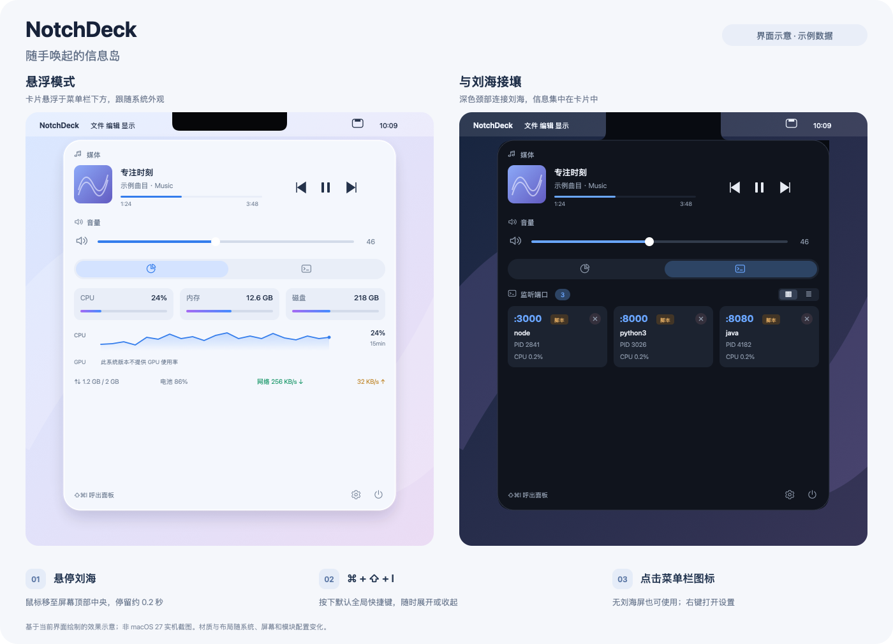

# NotchDeck

**V1.0 大版本：全面插件化。** 从 1.0.0 起，原有固定组件统一通过插件市场管理，官方插件目录与解析适配迁入独立仓库；升级保留原有配置与布局。详见 [V1.0 版本说明](docs/releases/v1.0.0.md)。

把 MacBook Pro 的刘海变成一个随手可用的信息控制台。

鼠标悬停刘海即展开**悬浮岛屿面板**，内容分为**顶部常驻 / 标签页 / 底部常驻**，支持媒体控制、系统监控、Node 进程管理、音量控制、用户自定义命令小部件、本地时钟，并可通过**插件市场**添加 AI 订阅额度。悬停检测仅读取鼠标坐标，**不需要辅助功能或输入监控权限**。

## 效果预览



左侧展示**悬浮模式**，右侧展示**与刘海接壤模式**。效果图根据当前界面绘制，曲目、端口和监控数值均为示例，**不是 macOS 27 实机截图**；实际玻璃材质与内容随系统外观、屏幕和模块配置变化。[查看 SVG 源图](docs/images/notchdeck-preview.svg)。

## 如何唤起信息岛

先启动 `NotchDeck.app`。应用在菜单栏运行，信息岛默认收起，不会弹出常驻主窗口。

| 唤起方式 | 操作 |
| --- | --- |
| **悬停刘海** | 将鼠标移到带刘海屏幕的**最上边缘中央**，停留约 **0.2 秒**，信息岛自动展开。默认开启，无需辅助功能或输入监控权限。 |
| **全局快捷键** | 按 **`⌘ + ⇧ + I`**（Command + Shift + I）展开；再次按下可收起。 |
| **菜单栏图标** | 单击菜单栏中的 **NotchDeck 小矩形图标**，即可展开或收起；右键单击（或按住 Control 单击）可打开“设置…”和“退出 NotchDeck”菜单。 |

**没有刘海的 Mac 或外接显示器**，使用快捷键或菜单栏图标即可。连接多个显示器时，面板优先显示在带刘海的内置屏；没有刘海屏时使用当前主屏。

默认开启“鼠标离开自动收起”，离开面板和刘海热区约 **0.5 秒**后收起。通过快捷键唤起且鼠标尚未进入面板时，面板会保持展开；也可再次按快捷键或单击菜单栏图标主动收起。

### 调整唤起方式和面板样式

点击信息岛右下角的**齿轮按钮**，或右键单击菜单栏图标选择**设置…**，进入**通用**页：

- **触发**：开关“悬停刘海自动展开”和“鼠标离开自动收起”；悬停延迟可调 **0.1～0.5 秒**，离开延迟可调 **0.3～2 秒**。
- **快捷键**：录制新的全局快捷键。如果默认组合键被其他应用占用，可通过菜单栏打开设置后更换。
- **面板**：开启“与刘海接壤（视觉一体）”切换为接壤样式；关闭则使用悬浮样式。无刘海屏自动使用悬浮样式。“液态玻璃面板”决定卡片是否使用系统的 Liquid Glass 材质（macOS 26 及以上可用，旧系统置灰并保留毛玻璃）；系统开启“减少透明度”或“增强对比度”时自动改用不透明背景。

设置还提供**关于**页：项目简介、当前版本、开源地址（[github.com/DeanWanghewei/NotchDeck](https://github.com/DeanWanghewei/NotchDeck)）与开源协议（MIT；内置 MediaRemoteAdapter 为 BSD 3-Clause）。

如果悬停没有反应，先确认应用正在运行、“悬停刘海自动展开”已开启，并把鼠标移到**刘海屏最上边缘**；也可以先用快捷键或菜单栏图标呼出面板。

## 功能

### 面板与交互
- 悬停刘海自动展开（默认 0.2s 延迟，可调 0.1~0.5s）；鼠标离开自动收起（默认 0.5s 延迟，可调 0.3~2s）
- 全局快捷键 `⌘⇧I`（可自定义录制）、菜单栏图标兜底（右键菜单含设置/退出）
- 悬浮岛屿样式：四角大圆角卡片悬浮于菜单栏下方，**不覆盖、不加宽刘海**；窗口最大 520 × 580pt，内容统一滚动，底栏保持可见
- 顶部常驻 → 标签页 → 底部常驻，空区域不占位，内容统一滚动；应用底栏始终可见。插件声明支持的区域、默认位置和展示样式，用户可覆盖选择，同一区域内可排序
- **展开/收起是面板轮廓自己的形变**：接壤样式的卡片从刘海里长出来、收起时缩回刘海，悬浮样式从顶缘中央展开；内容按展开后的位置一次排好、全程不移动，只被轮廓遮住或露出，窗口全程不动。全部动效曲线集中在 `Core/NotchMotion.swift`（约定见 [docs/design-conventions.md](docs/design-conventions.md) §4）
- **液态玻璃面板开关**（默认开启）：macOS 26+ 两种样式的卡片本体均使用系统 Liquid Glass（需 Xcode 26+ 构建），旧系统置灰并保留毛玻璃，关闭则使用不透明背景；接壤样式的颈部与凹角始终黑色、面板保持深色以融入硬件刘海，玻璃后压暗保证读数可读。跟随减少透明度、增强对比度与减弱动态效果设置
- 接壤模式按屏幕安全区与刘海对齐；换屏、切换空间或唤醒后同步刷新窗口与轮廓，无刘海屏自动使用悬浮卡片
- 设置使用侧栏导航，组件设置自动注册；各模块在自己的页面配置，新增组件不挤占顶部标签栏
- 插件市场：目录、脚本与发布校验由独立的 NotchDeck-Plugins 仓库管理；提供带数量的“全部 / 已安装 / 已停用 / 未安装”筛选和搜索；紧凑列表突出名称、用途与状态徽标，更新提示单独显示；详情按操作、功能、版本排序，支持直接启用/停用；明确区分随主程序更新的插件功能和可在应用内更新的 GLM 解析适配，旧版仍可添加与设置。公开目录只收录已正式发布的原生版本，离线目录随应用提供；检查时间统一 `yyyy-MM-dd HH:mm:ss`，刷新失败保留当前目录。设置窗口默认 980 × 700、最小 820 × 560，并记住调整后的尺寸与位置
- 全屏与 Space 切换后按面板自身窗口 ID 核验可见性；丢失时自动重挂恢复，收起会取消旧重试，恢复失败仍可再次悬停或按快捷键唤起

### 模块（可在设置中开启/关闭、选择区域和展示样式、上下箭头调整区域内顺序）
| 模块 | 说明 |
|---|---|
| 插件化组件 | 原有 7 个固定组件统一接入插件市场，可移除、重新添加；首次自动添加，保留启停状态、布局与配置，时钟仍默认关闭 |
| 媒体 | 封面/标题/进度/播放控制。媒体源由用户在设置中添加（Music / Spotify），**添加哪个才请求哪个的授权**，未安装的源不会出现在列表中 |
| 应用 | 用户从**已安装应用选择器**中挑选常用 App 添加到面板：一键启动/退出、运行状态，白名单应用带"已适配"标记（当前适配 Music、Spotify）。零权限（NSWorkspace 实现） |
| 音量 | 系统音量滑杆 + 静音切换，无需权限 |
| 系统监控 | CPU、内存、磁盘卡片 + **悬停卡片展开明细（点击可固定）**：CPU **每核占用**（核心名 + 用量条 + 百分比，冷→暖配色：低负载冷蓝、高负载暖红；性能/能效核标注、最忙核心、用户态/系统态拆分、负载）、内存**构成明细**（App 内存/联动/已压缩/已缓存/交换 swap）、磁盘**各挂载卷用量** + **CPU 近 15 分钟热力图** + **交换内存（swap）** + **电池**（电量/剩余时间与充满估算/循环次数及设计上限；容量/健康度/电压电流功率悬停查看详情）+ **热压力警示**（系统过热降速时提示，温度的公开 API 等价物）+ 网络速率，每秒刷新；各区块显示可在设置 → 系统监控 中开关。GPU 与风扇因当前 macOS 缺少可用的用户态统计接口（IOReport 框架在 27.3 上仍不存在、SMC 结构方法读不到数据，macOS 26 / 27.2 / 27.3 三轮探针实证）暂不可用，面板自动隐藏；实现零第三方依赖 |
| 进程监控 | **零配置**列出当前用户所有监听 TCP 端口的进程（系统守护进程除外）：App 名/脚本名智能展示、PID/端口/进程名、一键 SIGTERM、退出自动移除；受限环境（/bin/ps 被系统拒绝执行）下降级为只列端口与进程名，CPU/内存显示「—」而不是 0 |
| 时钟 | 本地时间、日期与时区：日期统一 `yyyy-MM-dd`，时间统一 24 小时制 `HH:mm:ss`，星期使用中文，不随系统语言切换格式；关闭秒数时显示 `HH:mm`，时区显示可配置。默认关闭，在模块管理中启用，无需权限 |
| 订阅额度（市场插件） | **GLM Coding Plan / ChatGPT · Codex / MiniMax M Plan 多账号**：可选别名、独立启停，以**百分比长条 / 圆环 / 紧凑长条**展示各额度的已用与剩余数字，重置时间以紧凑剩余时长（5 小时窗口 `2h5m`、周窗口 `2d3h17m`，保留零值单位）加 `yyyy-MM-dd HH:mm:ss` 绝对时间点直接显示（本地每分钟刷新），更新时间统一 `HH:mm:ss`；GLM 圆环合并为同心圆，外→内为 5 小时、每周、工具调用，右侧逐行对应，Codex 与 MiniMax 保持独立圆环；同服务多账号圆环支持自适应双列，窄窗口单列，支持账号卡片依次入场、读数逐位滚动及用量图形过渡（遵循减少动态效果），点击刷新后图标恰好转一圈；GLM 正确区分 5 小时与每周额度、完全重复项去重，重置时间直接读取接口 `nextResetTime`（epoch 毫秒或 RFC3339），缺失时明确说明、不估算；MiniMax 直读官方 `token_plan/remains` 接口的 5 小时与每周窗口剩余百分比，兼容数字与字符串百分比，不在套餐内的窗口不补零展示，认证失败按接口业务码区分（HTTP 仍为 200）。通过**设置 → 插件市场 → 添加插件**启用，添加账号后显示真实额度；支持顶部常驻、标签页、底部常驻。GLM 密钥与 MiniMax 订阅 Key 按账号加密保存于应用 Data 目录；Codex 直接粘贴**账号登录 JSON**，格式及登录错误分别提示，验证成功后独立加密保存登录，切换 CLI 当前账号或重启应用均不影响已保存账号。每 5 分钟独立刷新；GLM 解析脚本可从插件市场**应用内更新**（sha256 校验 + 无 I/O 沙箱 + 主机白名单，失败自动回退内置解析），无需重装应用；可开启系统消息提醒，已用阈值默认 100%、支持 1–100% 自定义，详见 [docs/subscription-quotas.md](docs/subscription-quotas.md) |
| 自定义 | 用户添加 shell 命令小部件，两种展示方式：**文本**（输出原样显示）与**热力图**（输出数字按大小着色、单行时间线，尚未采到的位置显示空轨道，命令失败/超时显示红色方格，保留时长 1~24 小时可配置）。**探测间隔可配置（10 秒 / 30 秒 / 1 分钟 / 5 分钟）**，文本子项只在面板展开时执行、不做后台轮询。设置页内置 **15 条示例模板**（按系统 / 网络 / 开发 / 通用分组一键添加：本机 IP、公网 IP、服务响应速度、DNS 解析耗时、Ping 丢包率、磁盘占用、磁盘剩余空间、CPU 总占用、CPU 前几名进程、内存占用百分比、电池电量、Git 分支与改动、本地端口监听、Docker 运行容器数、先登录再取数），完整写法见 [docs/custom-items.md](docs/custom-items.md) |

### 已适配白名单
`Modules/Apps/PanelApp.swift` 中的 `AdaptedApps.whitelist` 记录已深度适配的 App（bundleID → 能力说明）。用户在选择器或设置中看到这些应用时，会显示"已适配"徽章，表示 NotchDeck 为其提供超出启动/退出的集成能力（如媒体播放控制）。扩展适配只需在白名单加一行并实现对应集成逻辑。

### 权限模型（默认最小权限）
- 全新安装启动：**不发起任何 AppleScript、不申请任何权限**，面板完整可用（监控/Node/音量/应用/自定义/交互）
- 媒体模块默认显示"未添加媒体源"引导；用户在设置中开启某个源后，**该 App 运行后首次读取才触发自动化授权弹窗**，由 macOS 管理授权，拒绝也只影响该源
- 应用快捷控制走 `NSWorkspace` / `NSRunningApplication`，启动/退出用户自己的应用**无需任何权限**
- 悬停检测仅读取鼠标坐标（`NSEvent.mouseLocation`），无需辅助功能/输入监控权限
- 订阅额度默认未添加，无账号时不联网、不读取凭据；用户连接后才访问对应服务。额度提醒默认关闭，仅主动开启时申请通知权限；授权、投递及前台横幅由 Core 公共组件统一提供。GLM 密钥、MiniMax 订阅 Key 与已导入 Codex 登录均按账号以 AES-256-GCM 加密保存在应用 Data 目录，不访问钥匙串；旧版账号保留设置，凭据需重新填写或粘贴一次；Codex 接收用户粘贴的登录 JSON，验证后加密保存，不要求查找文件，不读取浏览器 Cookie
- 插件市场启动不联网；打开市场页会按一小时间隔静默检查，点击“检查更新”可立即刷新，仅向 GitHub 请求公开 JSON，无账号或凭据上传

### 插件市场与 GitHub

在设置侧栏打开 **插件市场**，列表仅展示名称、简介与状态，点击插件进入详情后可添加、查看使用说明与源码；已添加插件可打开设置或移除。详情页分别展示本机与目录版本，以及主程序下载入口和 GLM 解析适配安装/更新按钮。添加会启用插件，位置和展示样式可在模块管理或插件设置的“布局与展示”中选择。移除停止运行并保留配置；需要清除 GLM 密钥时在插件设置中单独删除。

公开目录、解析脚本、使用文档与发布校验由独立仓库 [NotchDeck-Plugins](https://github.com/DeanWanghewei/NotchDeck-Plugins) 管理，市场页面提供仓库入口。目录按插件 manifest 生成，CI 校验脚本哈希及原生版本是否已有正式安装包；Swift 实现仍随主应用编译发布。开发功能写入 [随附目录](marketplace/bundled-catalog.json)，供离线使用。主仓库旧目录与旧脚本地址保留供已发布客户端使用。新目录不会阻止添加本机兼容版本；原生升级需更新主应用，解析适配可独立安装并热加载。完整维护流程见 [marketplace/README.md](marketplace/README.md)。

## 模块框架

组件通过 `Core/ModuleFramework.swift` 的协议接入；原固定组件和可选插件统一由 `Modules/MarketplacePlugins.swift` 提供工厂：

```swift
protocol NotchModule: ObservableObject {
    static var descriptor: ModuleDescriptor { get } // 稳定 id、名称、图标、说明与默认布局
    var isAvailable: Bool { get }
    var unavailableReason: String? { get }
    func start()
    func stop()
    func panelDidExpand()
    func panelDidCollapse()
    associatedtype Content: View
    func content() -> Content
    associatedtype SettingsContent: View = EmptyView
    func settingsContent() -> SettingsContent
}
```

实现组件并在装配清单加入 `ModuleBox(YourModule(...))`，即可获得模块管理、区域/样式选择、排序与生命周期管理。`ModuleDescriptor.presentation` 声明可用区域、样式列表和宿主标题显示；视图通过 `@Environment(\.modulePresentation)` 读取用户选择后的区域和样式，用 SwiftUI 定义卡片、列表、曲线等内容。提供 `settingsContent()` 后，宿主会自动生成独立设置入口和布局设置。可用性、面板事件与无设置页的默认实现均由协议提供，不需要修改 `AppModel` 或设置页分支。

组件专属配置通过 `settings.modulePreferences(for:default:)` 保存 Codable 值，按组件 id 隔离；旧版内置配置继续兼容原来的存储键。注册表支持去重、移除与统一停止，停用或退出应用时释放轮询和订阅。新增的**时钟**组件使用这条完整链路，默认关闭，可独立设置秒数和时区显示。

插件市场使用同一注册表完成添加、移除与生命周期管理；安装列表与组件配置分别持久化，旧版订阅额度配置自动迁移。媒体、音量、应用、系统监控、进程监控、自定义与时钟均作为随附插件首次自动添加，保留原配置及默认顺序；显式移除后重启不会重新添加，重新添加时启用并恢复配置。第三方可通过 PR 贡献 Swift 插件，审核后随应用发布。完整接入示例、目录约定与测试要求见 [docs/module-development.md](docs/module-development.md)。

## 环境要求

- macOS 13 Ventura 及以上
- 带刘海的 MacBook Pro（无刘海的显示器上可通过快捷键 / 菜单栏图标呼出）
- Xcode 15+ 与 [xcodegen](https://github.com/yonaskolb/XcodeGen)

### macOS 27 展示适配

展示层使用公开 API 按系统能力适配，保留 macOS 13 的最低运行版本。窗口、颈部轮廓和悬停热区统一使用目标屏幕的几何数据，兼容菜单栏高度变化、侧边 Dock、缩放与多屏坐标；接壤模式显式处理 HostingView 安全区，避免刘海 inset 被重复计算。悬浮模式在 macOS 26 及后续版本使用系统玻璃效果，接壤模式保持深色以融入硬件刘海。两种样式的玻璃均由“液态玻璃面板”开关控制（见上）。

当前验证环境为 **macOS 27.3（Build 26C5035r）**、**Xcode 27.2（Build 27B52）**、SDK 为 **`MacOSX27.2.sdk`**；该环境下全量回归 **212 项测试 0 失败**。**macOS 27 尚未全面实机验证**，不能据此宣称已全面兼容：浅色/深色、两种面板样式、全屏/Space、外接屏切换及辅助功能外观仍需人工复核。系统监控卡已在 27.3 上完成深浅两版自渲染与色标审计（`scripts/audit-render.py` 可复现），但完整面板外观仍待人工复核。实验性系统正在播放仍按独立的媒体兼容状态显示，不将展示适配视为私有媒体接口已验证。27.3 上复核的平台结论（电池注册表键位、IOReport 仍缺失、SMC 读数不可用、应用启动冒烟）与各 macOS 版本的探针实证、窗口/电源等平台陷阱记录见 `docs/macos-notes.md`（v0.19.3 修复的 Space 搁浅问题亦在其中）。

当前 Debug 构建及全部 **259 项回归测试**通过（macOS 27.3 / Xcode 27.2 / `MacOSX27.2.sdk` 环境实测；其中 **50 项订阅额度测试、29 项市场测试、7 项时间格式测试**），覆盖组件生命周期、布局迁移、市场兼容性、多账号查询隔离、Codex 登录导入/验证/持久化与 token 轮换，额度阈值、周期去重、GLM 重置时间多形态解析、重置剩余时长与时间点展示与消息投递失败重试，MiniMax 订阅 Key 的业务码鉴权失败、字符串百分比、data 包裹层、窗口缺失与重置时间兜底解析，以及市场脚本下载校验、哈希防篡改、打开页自动检查节流、JSC 沙箱解析与内置回退。日期与时间格式已覆盖补零、24 小时制、中文星期、时区跨年、闰日及夏令时边界，并完成时钟（显示/隐藏秒数）、插件市场、额度长条/圆环/紧凑样式及窄窗口的深浅色自渲染目检。本次市场脚本化完成深浅色自渲染目检（含插件设置新增“GLM 解析脚本”分区）；真实系统通知横幅仍需在授权后实测。订阅额度及市场完成深浅色实际视图自渲染检查，覆盖添加前后、移除、最小窗口、三个区域、长条/圆环/紧凑样式、多账号、账号编辑与错误/需更新状态。新增覆盖自定义小部件的模板清单与分组完整性（标识符唯一、字段完整、含管道命令声明 pipefail、无机器特定路径、命令通过 shell 语法检查）、模板文档一致性（模板名与命令逐条对照）、取数解析边界（负数与百分号后缀、多行输出、千分位、截断上限、非有限值）、热力图探测间隔档位（默认 30 秒、跨重启持久化、非法值回退）与轮询行为（跟随配置间隔、文本子项不后台轮询），以及进程扫描降级（lsof `-Fpcn` 字段解析与旧解析器兼容、ps 不可用或非 0 退出时只列监听端口并保留 pid/端口/进程名、资源指标缺失标记为缺失而非补 0）。`cacheDisplay` 不能可靠还原系统玻璃材质，完整玻璃效果及辅助功能外观仍需人工复核。面板形变同样如此：`cacheDisplay` 把 `glassEffect` 画成全透明，`ImageRenderer` 根本画不出，所以像素断言只针对不透明表面；接壤玻璃的压暗值定在 0.6：实机复核确认材质本身几乎不压暗（卡片约为背景亮度的 0.4），亮色背景下白字对比度 6.2~7.8:1、暗色背景下 10.0~13.7:1。

macOS 27.2（26B118）上另用独立全屏测试应用验证了两轮进入/退出全屏：全屏内首次唤起、切回桌面、再次进入全屏与主动收起均正常。原始多事件叠加的偶发链路尚未受控复现，探针与修复细节见 [docs/macos-notes.md](docs/macos-notes.md)。

## 构建与运行

```bash
brew install xcodegen        # 首次
xcodegen generate            # 由 project.yml 生成 NotchDeck.xcodeproj
open NotchDeck.xcodeproj     # Xcode 中 ⌘R 运行
```

或纯命令行构建：

```bash
xcodegen generate
xcodebuild -project NotchDeck.xcodeproj -scheme NotchDeck -configuration Debug build
```

> `.xcodeproj` 由 `project.yml` 生成，已加入 .gitignore，修改工程配置请编辑 `project.yml`。

## 工程结构

```
NotchDeck/
├── project.yml                    # xcodegen 工程定义
├── App/
│   ├── NotchDeckApp.swift         # 入口（SwiftUI App + AppDelegate 适配器）
│   └── AppDelegate.swift          # 初始化窗口、菜单栏、快捷键、设置窗口
├── Core/
│   ├── ModuleFramework.swift      # 组件描述 + NotchModule 协议 + 注册表
│   ├── ModulePreferences.swift    # 按组件 id 隔离的 Codable 配置
│   ├── ModulePresentation.swift   # 区域与样式声明、用户覆盖、视图上下文
│   ├── NotchMotion.swift          # 运动词汇表：全应用动效曲线与面板形变时序的唯一出处
│   ├── Plugins/                  # 市场目录、兼容检查、缓存与插件生命周期
│   ├── AppModel.swift             # 单例聚合根：状态 + 模块 + 布局计算
│   ├── NotchWindowController.swift# 悬浮岛屿 NSPanel：状态机 + 屏幕定位
│   ├── PanelVisibilityRecovery.swift # 自身窗口可见性核验 + 可取消的 Space 恢复
│   ├── MouseTracker.swift         # 鼠标轮询（0.1s）悬停/离开检测
│   ├── HotKeyManager.swift        # Carbon 全局快捷键
│   ├── SettingsStore.swift        # UserDefaults 封装（含模块配置）
│   └── Shell.swift                # 外部命令执行（带超时）
├── Modules/
│   ├── MarketplacePlugins.swift   # 统一插件工厂与默认添加清单
│   ├── MarketplacePlugins.swift   # 市场插件工厂与实现版本
│   ├── Clock/                     # 本地时钟 + 专属显示配置
│   ├── Subscriptions/             # GLM / Codex / MiniMax 订阅额度与独立凭据存储
│   ├── Media/                     # 媒体：源注册表 + JXA / AppleScript（按需授权）
│   ├── Apps/                      # 应用快捷控制 + 已安装应用扫描
│   ├── Volume/                    # 音量：CoreAudio 默认输出设备
│   ├── System/                    # 系统监控：Mach 统计 / sysctl 64 位网络计数 / IOPS 电池估算
│   ├── Node/                      # Node 进程：lsof / ps / kill(SIGTERM)
│   └── Custom/                    # 自定义命令小部件
├── UI/                            # SwiftUI 视图（Settings/ 下按组件拆分设置页）
├── marketplace/                   # GitHub 维护的插件目录与贡献约定
├── docs/                          # 设计约束、命令小部件、组件开发、订阅额度与平台实证笔记
└── Resources/Assets.xcassets
```

## 设计要点

- **颜色与数据展示约定**：监控类 UI 遵循 [docs/design-conventions.md](docs/design-conventions.md)（项目约束）——连续负载用冷→暖色标（`HeatScale`，低负载冷蓝、高负载暖红，不用红绿灯配色）；百分比必须显示数字；自定义热力图绿色 5 档深浅 + 实色红失败格，失败色与任何数值档位可区分
- **最小权限**：默认安装零权限申请；媒体源按需添加、按需授权
- **多显示器**：优先使用带刘海的内置屏；无刘海时使用当前主屏。热区与面板保持在同一屏幕，窗口不超过可见区域
- **不碰刘海**：面板悬浮于菜单栏下方（留 6pt 间距），完全不覆盖刘海/菜单栏
- **动画**：展开/收起是轮廓的形变——形状参数写成数（`UI/PanelOutline.swift` 的 `PanelOutline`），由弹簧逐项插值，卡片从刘海里长出来；内容不动、只被轮廓遮住或露出，窗口全程不动。标签页滑动切换、按钮按压缩放反馈；全部曲线集中在 `Core/NotchMotion.swift`，遵守 [docs/design-conventions.md](docs/design-conventions.md) §4。窗口最大 520 × 580pt，内容统一滚动，底栏保持可见
- **媒体兼容策略**：MediaRemote 私有框架在 macOS 15.4+ 对第三方静默不应答且符号 ABI 已变化（ForOrigin 变体，错误调用会段错误），故不接入；媒体源在 `MediaModule.knownSources` 注册，通过有超时的 osascript 子进程读取；扩展新 App 时需适配其脚本字典、时间单位和封面格式
- **性能**：鼠标轮询 0.1s / 次，系统监控 1s / 次，Node 扫描 2s / 次（后台队列），采集在后台串行队列执行，关闭模块会停止轮询并取消任务
- **安全**：不收集任何数据，所有监控仅本地处理

## 回归验证

```bash
xcodegen generate
xcodebuild -project NotchDeck.xcodeproj -scheme NotchDeck \
  -destination 'platform=macOS' CODE_SIGNING_ALLOWED=NO test
```

`NotchDeckTests` 是无宿主逻辑测试，不启动 NotchDeck 主程序；设置写入临时 UserDefaults suite，媒体脚本使用模拟应用，不请求播放器授权。覆盖命令硬超时/取消/输出上限、组件默认值/配置隔离/生命周期/动态增删/设置导航、快捷键持久化、媒体元数据、系统采样（含每核占用差分/内存构成/挂载卷排序的原生断言与纯函数用例）、电池时间估算/循环上限/电压电流格式化、热压力标签与当前用户 TCP 监听扫描，以及刘海/无刘海、菜单栏自动隐藏、侧边 Dock、窄屏、负坐标多屏和悬停热区边界等布局场景。窗口恢复另覆盖其他窗口不能冒充面板可见、全屏过渡后丢失、重试上限、收起取消与旧回调失效。

面板形变与液态玻璃开关另有三层证据，均不需要启动主程序：

- **几何**：折叠态完全藏进硬件刘海、展开态与原「凸字形」逐点一致、中间每一帧都是夹在窗口内且不回退的合法轮廓、弹簧过冲被夹在窗口边缘、凹角补件全程落在卡片顶边的直线上；
- **逐帧**：屏幕外窗口里挂载真实的 `NotchDeckView`，逐帧采样形状求值——按窗口控制器的真实时序（先挂载、上屏后经回调翻转）从折叠轮廓经过中间轮廓长出来，内容遮罩与本体填充始终在同一个时钟上，减弱动态效果时直接落位，收起到状态机等待时刻屏幕上已经空了；
- **像素**：给定任意一份轮廓，真实视图树只在该着色的地方着色。

设置 `NOTCHDECK_RENDER_DIR` 后运行可导出深浅两版的折叠 / 中间 / 展开截图（`Tests/PanelMorphTests.swift`）。玻璃材质的合成结果需要屏幕录制权限才能截取：`Tests/PanelLiveCaptureTests.swift` 仅在设置 `NOTCHDECK_LIVE_CAPTURE_DIR` 时执行，会在屏幕顶部短暂弹出面板（约 40 秒），截取屏幕区域合成后的图像——两组画面：两种样式 × 两种外观 × 玻璃开关（含形变中间帧），以及接壤 + 玻璃下逐个插件的内容（应用 / 自定义 / 时钟 / 进程 / 订阅额度的入场、三种样式与读数变化）。订阅额度用测试替身喂样例账号，不触网。没有权限时它会在 2 秒内明确失败。热力图空轨道另由 `testHeatmapTrackFillsTheRowWithoutOverflowing` 钉住"恰好铺满一行"。依赖屏幕刷新时钟的逐帧用例会先做一次环境探针，在没有图形会话的环境里跳过并写明原因（本地全部执行）。

> **受限沙箱 / 部分 CI 环境**：上面这条标准命令可能因环境而非代码失败（DerivedData 不可写、Swift 宏插件服务器套了二层沙箱、测试运行器需要 pty、`/bin/ps` 被拒执行）。此时改用 `build-for-testing` + `xctest` 直跑的替代命令，逐条实证与可直接复制的命令块见 [docs/macos-notes.md](docs/macos-notes.md#受限运行环境下的验证方式)。

自定义命令每条最多执行 6 秒，超时或取消时结束本次命令的进程组；标准输出和错误输出各保留最多 256 KiB，并区分成功无输出、非零退出码与超时。模块关闭后不再执行命令，变更配置会取消旧任务并丢弃过期结果。热力图子项按设置中的探测间隔后台探测（默认 30 秒，可选 10 秒 / 1 分钟 / 5 分钟）；命令写法案例与规则见 [docs/custom-items.md](docs/custom-items.md)。

## 致谢

- [iStats](https://github.com/Chris911/iStats)（MIT License，© Christophe Naud-Dulude）：系统监控的电池时间估算、循环次数占设计上限、每核 CPU 占用采集（host_processor_info 差分）、温度展示思路参考了该项目；SMC 风扇/温度探针基于其 `ext/osx_stats/smc.c` 的经典协议实现验证。
- [MediaRemoteAdapter](https://github.com/ungive/mediaremote-adapter)（BSD 3-Clause License）：实验性「系统正在播放」的适配组件。
